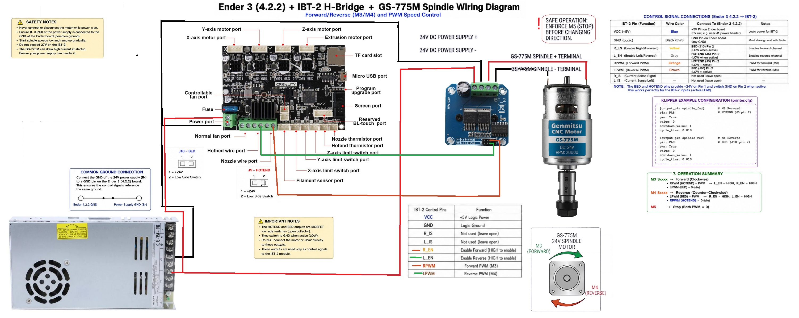
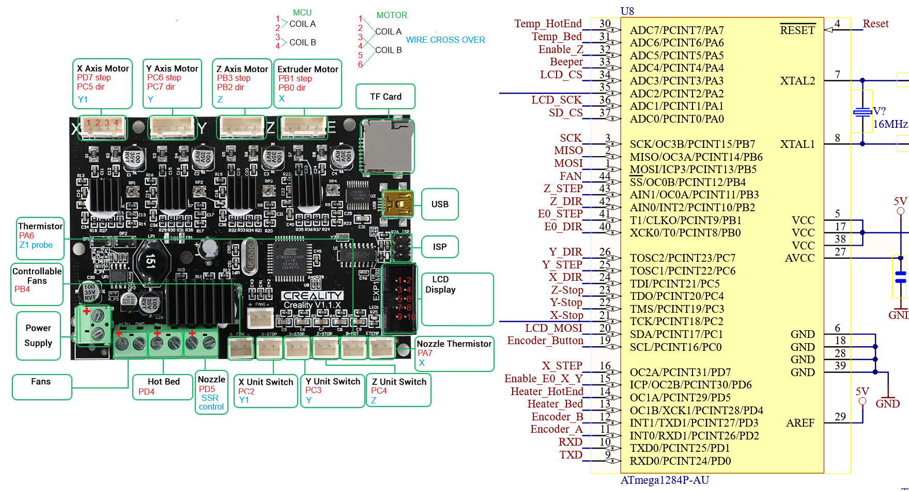
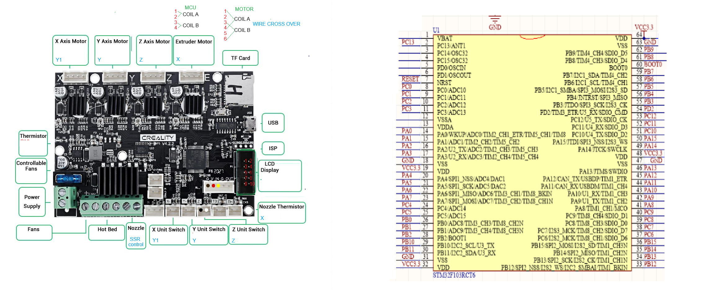
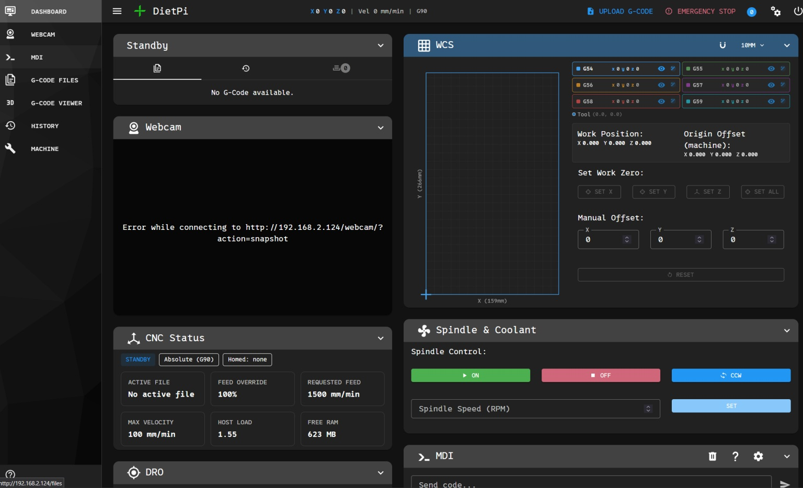
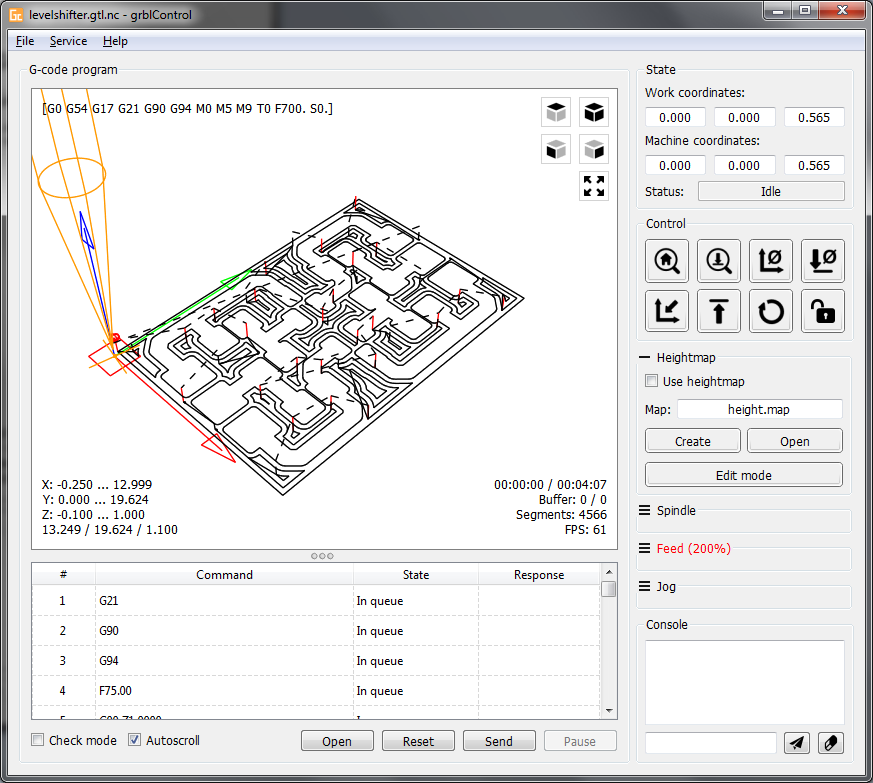
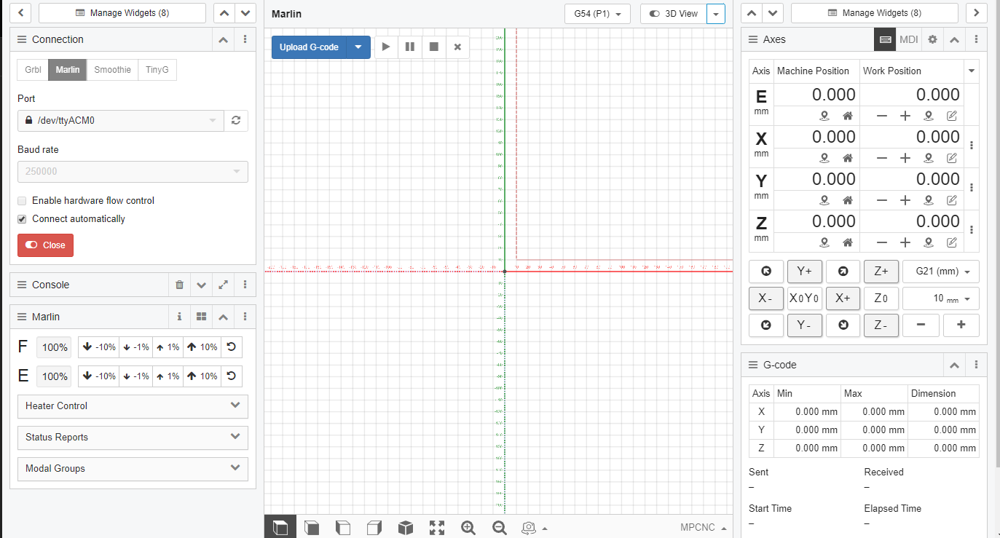
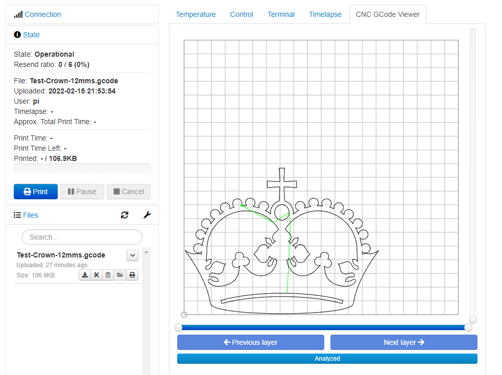
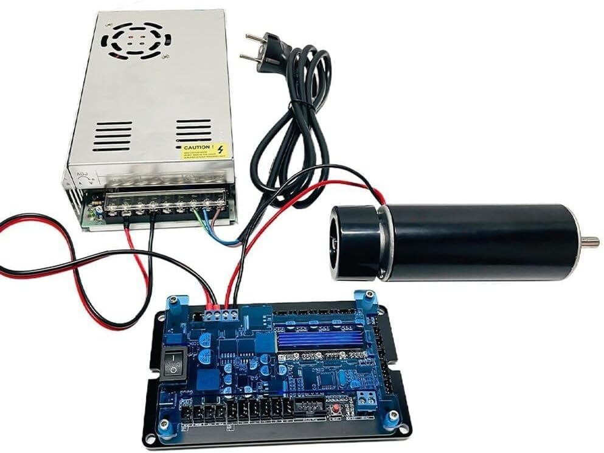
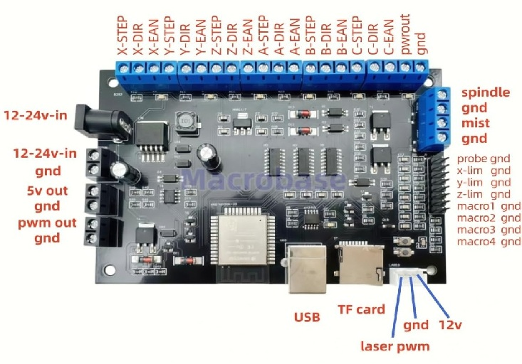
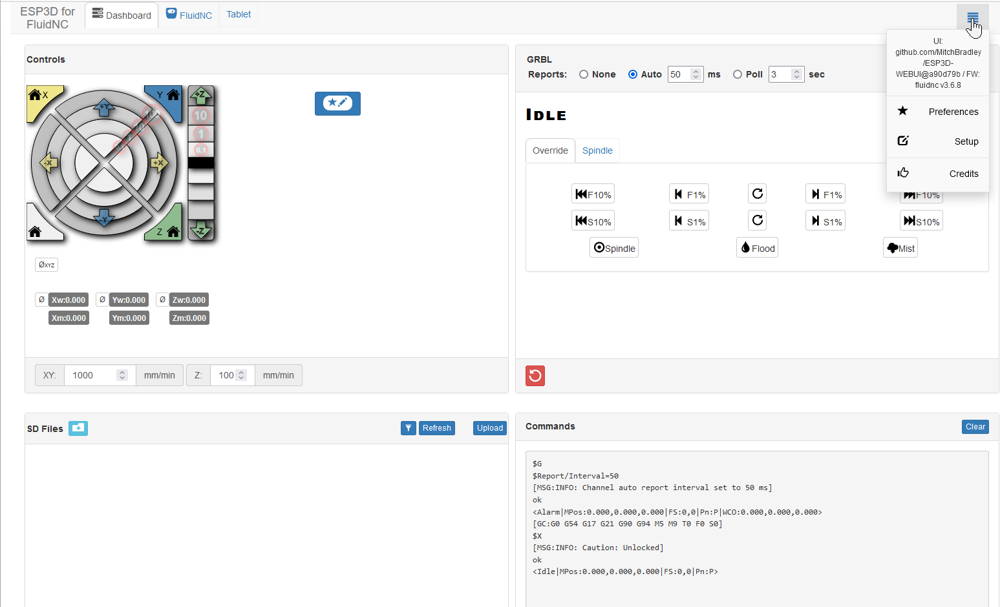

# Firmware Setup & Supported Options

Converting an Ender 3 into a CNC machine is a fun project, but adapting 3D printer hardware (especially firmware and pin mapping) for CNC subtractive manufacturing requires careful planning. Depending on which board you have will determine your options for firmware.

### Understanding the Workflow: Slicers vs. CAM Software

Before choosing your firmware, it helps to understand how your design files turn into machine movement, and why a CNC conversion changes your software toolchain:

* **Additive Slicers (3D Printing):** Standard 3D printing uses a **slicer** (like Cura, PrusaSlicer, or OrcaSlicer) that takes a 3D mesh model (typically an `.STL` or `.3MF` file), cuts it into flat horizontal layers, and generates G-code designed to lay down melted filament layer-by-layer.
* **Subtractive CAM Software (CNC):** CNC machining is the opposite—it is a subtractive process where material is carved away from a solid block. Instead of a 3D printer slicer, you use **CAM (Computer-Aided Manufacturing) software** (such as Fusion 360, FreeCAD, VCarve, PureCutCNC, Kiri:moto, E3CNC CAM or Carbide Create). CAM software takes precision engineering files (like `.STEP` or `.DXF` files) and calculates intelligent toolpaths (pockets, contours, facing, and drilling operations) based on your endmill size, spindle speed, feed rates, and material properties.

Here is a beginners' decision guide breaking down your options (**Marlin**, **Klipper**, and **grblHAL**), and another alternative (**FluidNC**).

---

## Firmware Comparison Matrix

| Firmware | Best Suited For | Pros | Cons |
| --- | --- | --- | --- |
| **grblHAL** | Native CNC operation & traditional G-code senders | Real-time motion, robust CNC features (tool offsets, accurate feedholds), native G-code support. | Harder to configure pin mappings manually for Creality 4.2.2 boards; limited documentation for custom board hacks. |
| **Klipper** | Flexibility, high performance, and macro automation | Extremely flexible config files (no recompiling to change pins), powerful macro language for spindle control. | Requires a secondary host computer (like a Raspberry Pi running Klipper/Moonraker). |
| **Marlin** | Users wanting a self-contained board with OctoPrint | Familiarity; works out-of-the-box with OctoPrint's CNC plugins. | Bloated for CNC; changing pin configurations requires recompiling source code via VS Code/PlatformIO. |

## Deep Dive into Your Firmware Options

### 1\. grblHAL (The Purist CNC Choice)

*   **Overview:** grblHAL is the modern evolution of classic GRBL, for 32-bit boards like the STM32 found on your v4 board. grblHAL will not work on the V1 Ender boards.
*   **The Good:** It is built _specifically_ for CNC mills and lasers. It handles acceleration, arc interpolation, and real-time jogging natively without the translation layers required by 3D printer firmwares. It pairs seamlessly with lightweight senders like **ioSender** or **UGS (Universal Gcode Sender)**. Many low cost Chinese CNC's are now using grblHAL so learning this will transfer to other machines.
*   **The Bad:** Configuring a custom pin map for a Creality v4 board in grblHAL requires using their web builder or editing source header files, which can have a steeper learning curve. You need a seperate machine to run the gcode sender.

### 2\. Klipper (The Power-User Choice and E3CNC preferred)

*   **Overview:** Klipper offloads heavy calculations to a host (like a Raspberry Pi) while the Creality board acts strictly as a low-level motor controller.
*   **The Good:** **No recompiling needed.** If you want to change your spindle pin, reassign the extruder port to run your second Y-motor, or tweak homing behavior, you just edit a text file (`printer.cfg`) and hit restart. Klipper handles dual-Y auto-alignment beautifully through macros and independent stepper definitions. You can also write custom macros to safely spin up the BTS7960 driver via standard PWM commands. Klipper works for both V1 and V4 Creality boards.
*   **The Bad:** It requires a host computer running Linux with the Klipper system to operate, adding a layer of network/hardware setup. Klipper is made for 3D printers, but has been customized for CNC software.

### 3\. Marlin (The Old School Choice)

*   **Overview:** Marlin is what your Ender 3 ran originally. It can be configured for CNC, and people often pair it with **OctoPrint** using the CNC Companion plugin.
*   **The Good:** If you already know how to configure Marlin (editing `Configuration.h` and `Configuration_Adv.h`), you can explicitly define a CNC machine profile, disable heated bed limits, and repurpose the extruder driver slot for your second Y-axis.
*   **The Bad:** Marlin is fundamentally a 3D printer firmware. Features like tool changes, proper work coordinate systems (G54–G59), and feed rate overrides are clunky or secondary compared to dedicated CNC platforms. Every single configuration change requires recompiling and reflashing via an SD card.

### What Other Firmware Might Be Viable?

*   **FluidNC:**  FluidNC is heavily used in modern CNC conversions. However, FluidNC is primarily designed for ESP32 microcontrollers. Ender V4 boards use a STM32 or V1 board use ATmega1284P. Unless you are willing to swap your Creality mainboard for somethng like an ESP32 NodeMCU breakout or other CNC shields), stick to grblHAL or Klipper for the stock hardware.

---

## Considerations for Specific Hardware Setup

1. **Dual-Y Motors & Extruder Port:** Using the extruder stepper driver (`E0`) to drive a second Y-axis motor requires remapping the stepper channels in firmware:
   * **Klipper:** Define an independent stepper section (`[stepper_y1]`) using the step/dir/enable pins assigned to the `E0` driver slot.
   * **Marlin / grblHAL:** Explicitly map driver channels in hardware definitions to duplicate the Y-axis rather than treating the driver as an extruder.
   * **FluidNC** make sure the controller has enough drivers to handle the dual y, many only come with 3 drivers.
2. **BTS7960 Driver & Hotend Port:** High-current BTS7960 motor drivers require clean PWM signals and logic-level enables:
   * Map the hotend heater MOSFET pin (`PA1` on Creality v4.2.2) as a dedicated hardware PWM spindle output (`M3`/`M4`).
   * Ensure printer-focused thermal runaway safety checks on that pin are disabled in firmware.
3. **SSR** Switching Relays (for high-power motors): A relay board is required to switch high-power motors and to isolate the mainboard from the high voltage of other components like mains power for vacuum or on/off spindles.

## Recommendation

If you already have a Raspberry Pi or a mini-PC running things like OctoPrint or Klipper ecosystems, **Klipper** gives you the easiest path to reconfigure pins on the fly without repeatedly flashing firmware binaries. If you want a dedicated, standalone machine controller that behaves precisely like an industrial CNC, look into **grblHAL**.

---

## Klipper Setup

Install via KIAUH on a Raspberry Pi or Linux machine, deploy a reference `printer.cfg`, and verify motor direction and pin mappings prior to powering high-voltage spindle circuits. Follow standard Klipper installation on your Raspberry Pi or Linux laptop. We recommend [dw-0/kiauh](https://github.com/dw-0/kiauh) to get started.

*   Make sure the stepper, endstop, spindle, and belt parameters are correct for your MCU
*   Make sure all motors are spinning correctly and settings are correct for your MCU

Test all axes manually before enabling motor power. Leave belts disconnected when testing motor directions.

Configure homing and probe offsets for your spindle.

### Example configs

*   [Version 1.1.x Ender MCU printer.cfg](https://github.com/john-clark/EnderCNC/blob/main/klipper/v1.1.x_printer.cfg) Original Ender 3
*   [Version 4.2.2 Ender MCU printer.cfg](https://github.com/john-clark/EnderCNC/blob/main//klipper/v4.2.2_printer.cfg) Ender 3 Pro
*   [Version 4.2.7 Ender MCU printer.cfg](https://github.com/john-clark/EnderCNC/blob/main//klipper/v4.2.7_printer.cfg) Latest Ender 3 pro

### How to document your mainboard

Notice in the picture that the processor and motor has documented pins. 

### ***!!!! STILL TO BE COMPLETED !!!!***

#### V1

#### V4

#### Example of Klipper that has E3CNC customizations

---

## GRBL Setup

1.  Flash your board: Download or build the appropriate grblHAL binary for your STM32-based Creality board (v4.2.2 or v4.2.7...V1 will not work) using the grblHAL web builder or pre-compiled repositories. Flash via an SD card using the standard .bin file naming convention.
2.  Configure Pin Mappings & Settings: Connect via a USB G-code sender (ioSender or UGS) and use $ configuration commands to set steps per millimeter, max rates, acceleration, and homing directions. You will need to customize the source or pin mapping table to configure the second Y-axis stepper mirroring and map the PWM spindle pin to the hotend heater port (PA1).
3.  Test Motion: Check limit switches ($X or ? status commands) and test axis movement manually at low feed rates with belts detached before sending actual G-code jobs.

**Typical GRBL CAM software**

*   [ioSender](https://github.com/terjeio/ioSender) (Recommended for grblHAL)
*   [Candle](https://github.com/Denvi/Candle)
*   [OpenBuilds](https://software.openbuilds.com/)
*   [PlanetCNC](https://planet-cnc.com/download.html)
*   [PrintNC](https://wiki.printnc.info/en/grbl)
*   [Foam cutters (good info)](https://rckeith.co.uk/grbl-hotwire-for-cnc-foam-cutters/)

---

## Marlin Setup

1. **Environment Setup:** Download the Marlin source code and the matching `Configurations` repository. Open the project in **VS Code** using the **PlatformIO** extension.
2. **Modify Configuration Files:**
   * Open `Configuration.h` and set your motherboard definition (`#define MOTHERBOARD BOARD_CREALITY_V422` or similar).
   * Update axes limits (`X_MAX_POS`, `Y_MAX_POS`, `Z_MAX_POS`) to match your CNC working area.
   * Disable thermal protections or configure the hotend temperature target behavior so it functions purely as a manual or G-code-driven PWM spindle control (`SPINDLE_FEATURE`).
   * Configure ganged dual-Y settings if your board supports explicit multi-stepper definitions, or assign the extruder driver slot (`E0`) to duplicate the Y-axis.
3. **Compile & Flash:** Build the firmware in PlatformIO, copy the generated `firmware.bin` file to the root of a FAT32-formatted micro-SD card, insert it into the powered-down Ender 3, and turn it on to flash.
4. **Testing:** Connect via OctoPrint (using the CNC Companion plugin) or a direct serial monitor to verify manual jogging and spindle toggle commands (`M3 S1000` / `M5`) before mounting any tooling.

---

**FluidNC**

**[FluidNC](https://eghasemy.github.io/FluidNC_GUI/docs/getting-started/understanding-fluidnc/)** is an extremely powerful, Wi-Fi and Web-UI enabled CNC firmware, but it natively targets **ESP32** microcontrollers rather than the stock Creality STM32 or ATmega boards.

**When to use FluidNC on an Ender conversion:**
You decide to upgrade your machine by replacing the stock Creality mainboard with an ESP32-based CNC controller board with configuration via simple YAML files and web browser control. This is probably a much simpler solution than reusing old hardware.

**Alternative Board Upgrade Example:**

1. Connect the ESP32 board to your computer via USB.
2. Flash the FluidNC firmware binary using Web Installer or ESPTOOL.
3. Upload a custom `config.yaml` file defining your stepper pins, microstepping jumpers, limit switches, and PWM spindle pin mappings through the built-in Wi-Fi captive portal.
4. Verify axis travel directions and safety interlocks.

Make sure your board has the required stepper drivers this one

and not this one:

FluidNC Screenshot

---

### IMPORTANT NOTES

> Don't let the magic smoke out!

!!! tip  
Keep a backup of working firmware configuration before making major changes.

!!! warning  
Never run motors at full speed during first test

!!! warning  
Verify wiring because Creality motors have crossover wires.

!!! warning  
Y axis has one motor inverted. Test Y motor without belts first.

---

## Ready to Proceed?

You have now completed Ender3CNC build and you can now do **Trouble Shooting** or move onto **Post Processing**.

[Troubleshooting →](/EnderCNCs/troubleshooting) [Post Processing →](/EnderCNCs/cad/post_processing)